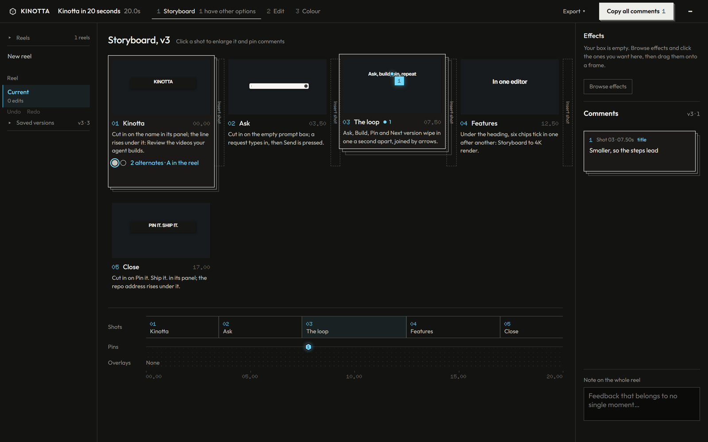
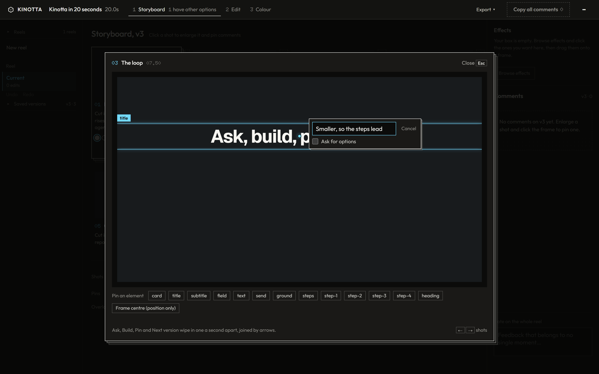
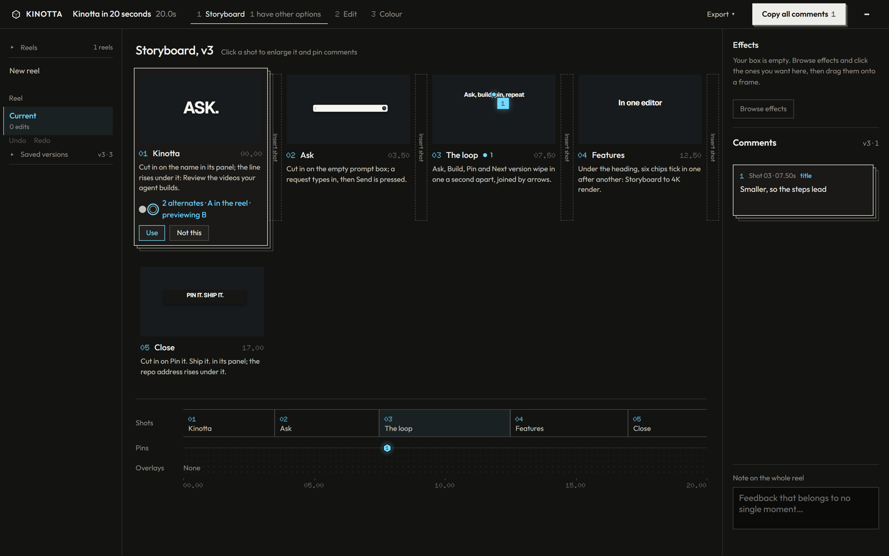
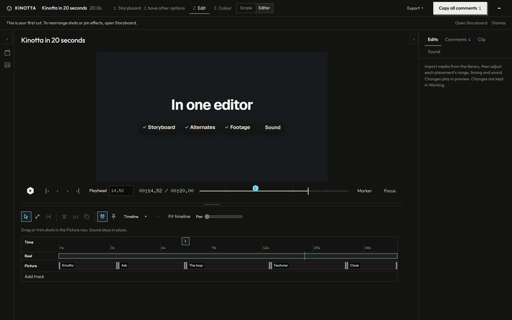

# Kinotta

Kinotta is a local review editor for videos that an AI agent builds. You ask Claude Code (or Codex)
for a reel inside your own project. The agent builds it as code, using your footage, your brand and
your taste notes. You review it in Kinotta, pin comments to the exact thing you want changed, and
the agent builds the next version from those comments. Everything stays in your project folder.



## How the skill works

Kinotta is two parts: the **editor** (the `kinotta` command) and the **Kinotta skill**, which
teaches the agent how to build reels the editor can open. The skill lives in
[`skill/kinotta/`](skill/kinotta/SKILL.md).

1. **Set up once per project.** The skill finds your brand sources (a `DESIGN.md`, logo, fonts,
   voice notes) and records where they live in `reels/brand.md`. It points at your files and never
   copies their values. With no brand, it uses Kinotta's built-in one.
2. **Direction.** Before the first build, the skill asks only what the request leaves open: format,
   length, the moments in order, style, sound. In the editor you can answer the same questions
   through the Direct steps instead, or pick Auto to build in your usual style.
3. **Build.** Every shot is an HTML page that follows a **timing contract**: timed scenes, named
   elements, and a `seek(t)` that jumps to any moment. That contract is what lets the editor pause,
   scrub and pin any frame. Footage reels add motion-graphic b-roll, captions and cutaways over your
   video, built from a transcript of its audio.
4. **Review.** You open the reel in Kinotta and pin comments to named elements, positions or words
   of the transcript.
5. **Next version.** You send the comment batch back. The editor runs the agent for you, or copies
   the batch for you to paste. The agent builds a new version, answers each comment as done, partly
   done or not done with a reason, and runs `kinotta check` before handing it over.

Versions are frozen once saved, so every earlier version and its comments stay as history. Small
mechanical changes (gain, timing, captions, an element's position) are edits to **Working** that
you can undo, not new versions.

## Skill commands

Type these in Claude Code inside your project. Each one runs one step of the skill and ends with
something for you to check.

| Command | What it does | What it writes | What you do next |
|---|---|---|---|
| `/kinotta setup` | Starts a project: checks that Kinotta is installed, finds your brand sources (or offers the built-in brand, another project's brand, or colours and fonts you type in). | `reels/brand.md`, and a `CONTEXT.md` map of where things live | Confirm the brand summary once |
| `/kinotta direction` | Asks only what the brief leaves open (format, length, the moments in order, style, sound) and can show numbered choice sheets of fonts or looks. | The reel's notes and any choice sheets | Pick an option |
| `/kinotta alternates` | Builds 2 to 4 animated options for a shot, recommended one first, each with a title and a one-line note. | New shot revisions and the shot list | Preview, Use or Not this in the Storyboard |
| `/kinotta sound` | Adds a score, sound effects or voiceover as audio tracks, generated locally. | Audio tracks and placements, and the generated sound files | Listen and adjust in the editor |
| `/kinotta check` | Looks at stills of each beat for anything cramped, clipped or unreadable, then runs `kinotta check`. | Its findings in the reel's notes | Review the checked reel |
| `/kinotta edit` | Makes a small change (gain, mute, timing, captions, a word, an element's position) without building a new version. | An edit to Working, through `kinotta edit` | See it under Edits; undo if you want |

Some steps start from what you do rather than from a command:

| You | The skill |
|---|---|
| Ask for a reel ("make a 20-second launch reel") | Sets up the brand if needed, asks what's missing, builds v1 as shots from the effect templates, and checks it. |
| Ask for b-roll over a video | Transcribes the audio, fixes misheard names, splits long videos into sections, and builds animated b-roll and captions over it. |
| Paste a batch that starts with `Kinotta comments:` | Builds the next version from your pins, changing only what the comments name, and answers each one as done, partly done or not done. |
| Press Auto or Regenerate in the editor | Kinotta runs the agent for you and checks its output before showing it. |

Behind these, the skill calls the `kinotta` command: `kinotta build` publishes a new version,
`kinotta check` tests it against the timing contract, `kinotta edit` records a small change, and
`kinotta render` makes the video file. It never edits a saved version and never approves one for
you.

## Main features

- **Storyboard.** Every shot is shown as the live page paused at its moment, not a screenshot.
  Hover a shot card to play it.
- **Pin the element, not the pixel.** The element under the cursor is outlined and named before you
  click, so "make this darker" is never ambiguous.
- **Alternates in place.** Ask for 2 to 4 options of a shot. Preview them in the shot card, switch
  with the arrow keys, and pick one with Use. Ctrl+Z undoes it.
- **Review playback.** Play and scrub the whole reel, footage and sound included.
- **Footage reels.** Drop in a video: Kinotta transcribes it, splits long videos into sections and
  adds b-roll, captions and cutaways. Double-click a caption word to fix it.
- **Sound.** Audio tracks with gain and mute, a synthesized score and sound effects generated
  locally, and optional local voiceover.
- **Colour.** A Colour view with grading wheels; the graded preview matches the exported file.
- **Effects library.** Ready-made motion shots (title card, big word, number cut, before and after,
  floating cards, text behind you, captions, phone, charts and more), restyled to your brand.
  WebGL shots with Three.js for a filmed, 3D look.
- **Simple mode.** Start from a video or a short brief, pick Auto or Direct, and use Regenerate to
  rebuild with only your new or changed pins.
- **Render.** Draft, Final and Overlay (transparent) presets, 1080p by default with 4K available,
  through a render queue the editor and the command line share.

## Screens

The screenshots show a 20-second demo reel the Kinotta skill built on the built-in brand, at its
third version.

**Pin the element.** The element under the cursor is outlined and named; the comment lands on it.



**Alternates in place.** The first shot has two options. The card previews option B, and Use puts
it in the reel.



**Edit and play.** The whole reel plays in the editor, with shots on a timeline and pins at their
moment.



## Install

You need Node 20 or later. For footage reels and rendering you also need:

| Tool | Needed for | Install |
|---|---|---|
| ffmpeg | footage and rendering | `winget install ffmpeg`, `brew install ffmpeg` or `sudo apt install ffmpeg` |
| Python 3 with numpy and scipy | footage, synthesized sound | `pip install numpy scipy` |
| faster-whisper | transcribing footage | `pip install faster-whisper` |
| Chromium for Playwright | rendering, and checking each agent build before it reaches you | `npx playwright install chromium` |
| Claude Code or Codex | building reels | see each tool's install guide |

The editor lists anything missing when you start a reel from a video.

Then clone this repo and run, inside it:

```
npm install
npm run build
npm link
npm run install-skill
```

`npm run build` builds the editor UI. `npm link` puts the `kinotta` command on your PATH; open a new
terminal afterwards so it is found. `npm run install-skill` links the skill into
`~/.agents/skills/kinotta` and from there into `~/.claude/skills/kinotta`, where Claude Code finds
it. These are links, so `git pull` followed by `npm run build` updates both the editor and the skill.

## Use

Inside any project folder:

- `kinotta` opens the editor on the project's `reels/` folder.
- Ask the agent for a reel, or use `/kinotta setup`, `/kinotta direction`, `/kinotta alternates`,
  `/kinotta sound`, `/kinotta check` or `/kinotta edit`.
- `kinotta check <reel> [version]` lists a version's contract issues and exits non-zero when there
  are any.
- `kinotta render <reel> v<n> --preset draft|final|overlay` renders a saved version. `--fps`,
  `--size`, `--quality` and `--audio` change one render. `check` and `render` take
  `--project <dir>`.

## Development

| Command | What it does |
|---|---|
| `npm run dev` | The UI with hot reload, next to a running `kinotta` on port 4317 |
| `npm run typecheck` | TypeScript, no output |
| `npm test` | Tests (Vitest) |
| `npm run test:e2e` | End-to-end tests in Chromium (Playwright) |

## License

MIT with the Commons Clause. You may use, change and share Kinotta, including to make videos you
are paid for. You may not sell Kinotta itself, or a hosted or support service whose value comes
mainly from it. See [LICENSE](LICENSE).
